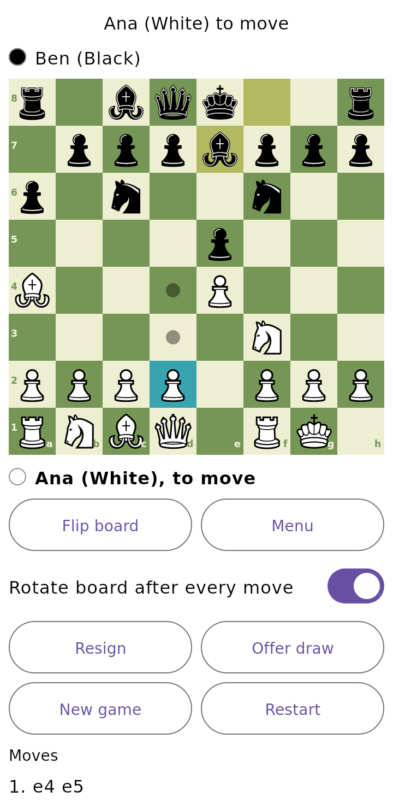
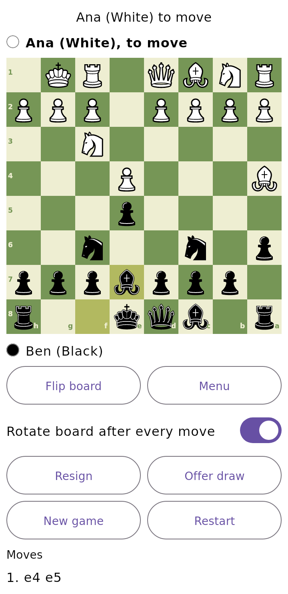
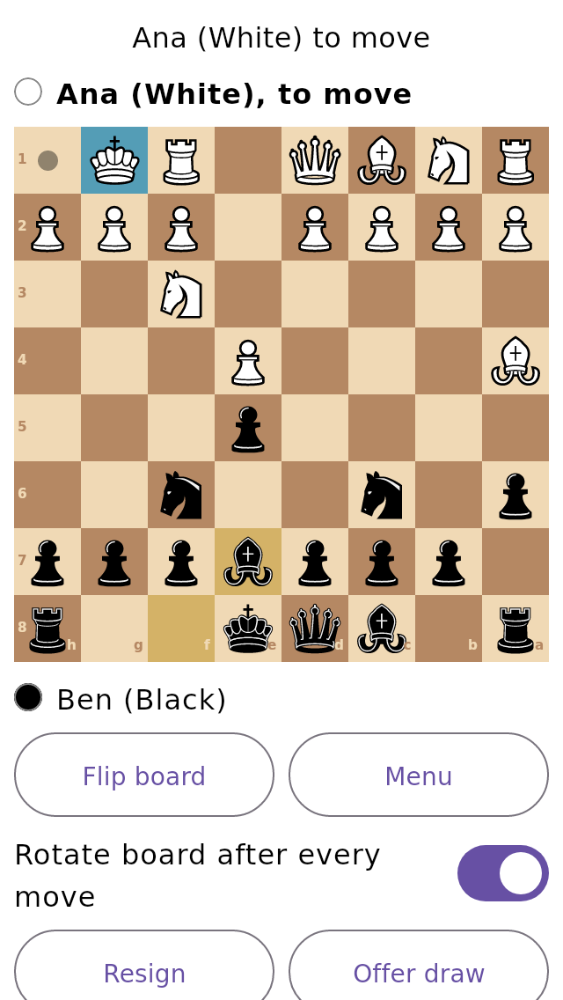
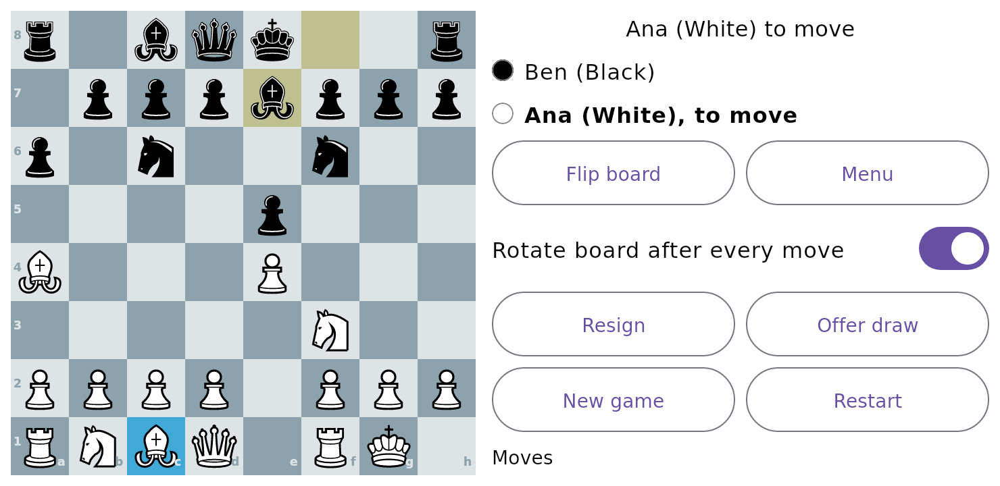
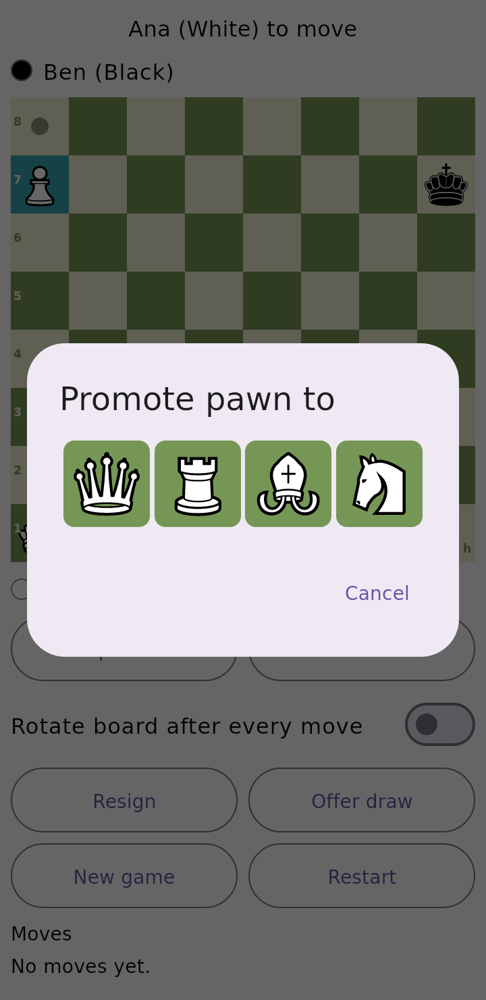

# Casual Chess (Android)

An English-language chess app for casual players. **Milestone 1:** fully playable two-player chess on one phone,
completely offline, with full standard chess rules, automatic board rotation, autosave/resume and settings.
No accounts, no servers, no API keys, no ads, no network permission.

| Selected piece, legal moves, last move | Board rotated 180° (pieces stay upright) | Small phone (320 dp) | Landscape | Promotion chooser |
|---|---|---|---|---|
|  |  |  |  |  |

> **Screenshots are not from an Android device.** They were rendered headlessly from the real Compose screens using
> Compose Multiplatform 1.5.12 on a desktop JVM, because no Android SDK/emulator was available where this was
> written. Real-device appearance may differ slightly. See [What has and has not been verified](#what-has-and-has-not-been-verified).

## Project layout

```
chess-core/   Pure Kotlin/JVM library - NO Android dependencies. All chess logic lives here and is fully unit-tested.
  Position.kt       immutable position, legal move generation, FEN, castling / en passant / promotion, dead-position check
  ChessGame.kt      game history, results, draw rules (claimable vs automatic), resign / agreed draw
  San.kt            move notation for the history list
  SessionState.kt   UI state machine: tap-to-move, promotion, board rotation timing (pure functions, testable)
  BoardGeometry.kt  the ONE mapping between screen cells and squares, used for drawing AND touch (both orientations)
  GameCodec.kt      versioned text save format (start FEN + moves; everything else is rebuilt by replay)
  Describe.kt       English status / result / history / accessibility text
app/          Android app (Jetpack Compose UI, thin layer over chess-core)
  AppViewModel.kt   owns the game, settings and the rotation timer; survives configuration changes
  Storage.kt        SharedPreferences autosave (private to the app)
  ui/               Home, Setup, Game, Settings screens, board, dialogs, piece drawing
assets-src/       Original Chessnut SVG pieces + licence; tools/ regenerates PieceArt.kt and the sound files
docs/             ROADMAP.md, KNOWN_LIMITATIONS.md, ENGINE_EVALUATION.md, CHESS_LIBRARY_DECISION.md
```

Separation of concerns: **chess logic** (`Position`, `ChessGame`) → **game/session state** (`SessionState`) →
**persistence** (`GameCodec` format + `Storage` on Android) → **UI** (`app/ui`).

## Requirements

| Tool | Version | Notes |
|---|---|---|
| Android Studio | a current stable release that supports AGP 9.4 | Easiest route: it installs the SDK pieces below for you |
| JDK | 17 or newer | Android Studio's bundled JDK is fine |
| Android SDK Platform | **36** | `compileSdk`/`targetSdk` = 36 |
| Android SDK Build-Tools | **36.0.0** | required by AGP 9.4 |
| Gradle | 9.8.1 | downloaded automatically by the wrapper (`./gradlew`); AGP 9.4 needs ≥ 9.6.0 |

Versions in `gradle/libs.versions.toml`, chosen from Google's official documentation on 2026-10-10:
AGP **9.4.0**, Kotlin **2.4.21**, Compose BOM **2026.09.00**, activity-compose **1.13.0**, lifecycle **2.11.0**.
`minSdk` is 26 (Android 8.0). The app requests **no permissions**.

**Google Play:** from 31 August 2026 new apps and updates must target Android 16 (API 36) or higher
([source](https://developer.android.com/google/play/requirements/target-sdk)); this project targets 36.
Before publishing, change `applicationId` in `app/build.gradle.kts` (`com.casualchess.app` is a placeholder) to an ID
under a namespace you control, set up app signing, and check Play Console for any account/testing requirements that
apply to your developer account (not verified here).

## Set up

1. Install Android Studio and open the `ChessApp` folder (this directory, containing `settings.gradle.kts`).
2. Let Gradle sync. In *SDK Manager* install **Android 16 (API 36)** and **Build-Tools 36.0.0** if prompted.
   Android Studio writes `local.properties` (with `sdk.dir`) for you; it is git-ignored.
3. Command line only: set `ANDROID_HOME` (or create `local.properties` with `sdk.dir=/path/to/Android/Sdk`).

## Build, test, install

Run from the `ChessApp` directory (`gradlew.bat` on Windows).

```bash
# 1. Chess engine + game-logic unit tests (115 tests). Needs only a JDK, no Android SDK:
./gradlew :chess-core:test -Pchess.coreOnly=true

# 2. Everything JVM-side with the Android project configured:
./gradlew test

# 3. Build a debug APK  ->  app/build/outputs/apk/debug/app-debug.apk
./gradlew :app:assembleDebug

# 4. Install on a connected phone (USB debugging on) or a running emulator, then launch it:
./gradlew :app:installDebug
#    or manually:
adb install -r app/build/outputs/apk/debug/app-debug.apk

# 5. Instrumented UI tests (need a device/emulator):
./gradlew :app:connectedDebugAndroidTest

# 6. Lint:
./gradlew :app:lintDebug

# 7. Release bundle for Google Play (configure signing first; Play App Signing recommended):
./gradlew :app:bundleRelease
```

`-Pchess.coreOnly=true` makes `settings.gradle.kts` skip the `:app` module, so the engine can be built and tested on any
machine (or CI job) without the Android SDK.

### Device checks to do manually (not automated)
Small screens (e.g. 320×568 dp), landscape, split-screen/resize, font scale 200 %, dark mode, rotating the phone mid-game
(the game and the board orientation must survive), force-stopping the app mid-game and resuming, TalkBack.

## What the app does (milestone 1)

* **Home / setup:** resume, new two-player game (player names, rotate-board option), settings, about & licences.
  "Play the computer" is shown as *coming soon* (milestone 2).
* **Complete standard rules:** legal moves, no moves that leave your king in check (pins), castling (not out of, through
  or into check; rights lost correctly incl. when a rook is captured), en passant (immediately only, and illegal if it
  exposes the king), promotion with a queen/rook/bishop/knight chooser, check, checkmate, stalemate.
* **Draws, FIDE style:** *claimable* - threefold repetition and the 50-move rule (buttons appear when available);
  *automatic* - fivefold repetition, the 75-move rule (a mating 75th move is still a win), stalemate and dead positions;
  plus resignation (either player, chosen explicitly) and agreed draws (confirmation dialog).
  Repetition follows FIDE's definition: castling rights count, and an en passant square counts only if a capture is legal.
* **Board rotation (two players, one phone):** after each completed move the move stays visible (last-move highlight) for
  0.9 s, then the board turns 180°. Tapping during that moment rotates immediately. Both the drawing and the touch
  mapping use `BoardGeometry`, so a tap always hits the square shown under the finger. Pieces stay upright. A *Flip
  board* button and an *auto-rotate* switch (per game, with a default in Settings) are provided.
* **UI:** large responsive board, coordinates, selected-square, legal-move dots/rings, last-move and check highlights,
  tap-to-select / tap-to-move, turn and status text, move history, 48 dp buttons, screen-reader descriptions per square.
* **Autosave & resume:** after every move (and on stop). Saved: start position + all moves + manual result + names +
  orientation. Castling rights, en passant, counters and the whole repetition history are rebuilt by replaying the moves
  through the rules engine, so a resumed game has identical legal moves and draw eligibility. Corrupt saves are ignored.
* **Accidental-loss protection:** *Restart* asks first; *New game* goes to setup and asks before discarding an unfinished game.
* **Settings:** four board colour themes, sound on/off, default for auto-rotate.

## Testing

`chess-core` has **115 JUnit tests** (all pass):

* **Perft** (7 positions incl. the start position, "Kiwipete" and the standard castling/en-passant/promotion/pin stress
  positions) - counts every reachable position to depth 4-5 and compares with the published reference numbers.
* **Rules:** pins and illegal king exposure, castling through/out of/into check, rights loss, en passant (immediate only;
  exposing-the-king case; capture of a checking pawn), underpromotion (incl. a knight check the queen cannot give),
  checkmate, stalemate, SAN notation.
* **Dead-position proof:** a brute-force enumeration of every legal K+N vs K and K+B vs K placement finds no checkmate
  (so those are genuinely dead), while K+R / K+Q do have mates and a K+N+N vs K mate position exists (not dead).
* **Draws:** threefold claim vs fivefold automatic, 50-move claim vs 75-move automatic, mate on the 75th move, repetition
  with changed castling rights / en passant, dead positions, resignation, agreement.
* **Save/resume:** legal moves, repetition counts, draw eligibility, en passant right, move counters and manual results
  survive; corrupt, truncated, illegal or forged saves are rejected.
* **Session/UI logic:** select/move/promotion flow, auto-rotation timing, stale timers, manual flip, **touch mapping
  after rotation** (cell ↔ square for both orientations, pixel-level too).

*Mutation check:* deliberately breaking four rules (castling transit check, en-passant expiry, dead-position material,
repetition ignoring castling rights) made 4, 11, 1 and 1 tests fail respectively, so the tests do detect rule bugs.

`app/src/androidTest` has two instrumented UI tests (rotation after a move; activity recreation). **They have not been run.**

## What has and has not been verified

Environment used to write this: Linux container, JDK 21, Gradle, **no Android SDK, no emulator, and no access to Google's
Maven repository / SDK downloads** (blocked), so AGP, AndroidX and Compose-for-Android could not be downloaded.

| Check | Result |
|---|---|
| `./gradlew :chess-core:test -Pchess.coreOnly=true` (Gradle 9.8.1, Kotlin 2.4.21, JUnit 5) | **Ran: 115 tests, 0 failures** |
| Perft node counts vs published values | **Ran: all match** |
| Mutation check of the tests | **Ran: all 4 mutations caught** |
| Type-check of **all** app Kotlin (ViewModel, storage, sound, activity, every Compose screen) | **Ran, compiles cleanly** - against the real `chess-core`, real Compose Multiplatform 1.5.12 (an *older* Compose than the 1.12.x the Android build will use, so newer-only APIs would show up as errors but API changes since 1.5 are not checked) and small hand-written stand-ins for Android classes. It caught and fixed one real bug (a missing import). |
| Headless rendering of the real screens (screenshots above) | **Ran** (portrait, rotated, 320 dp phone, landscape, tablet, promotion & game-over dialogs, home/setup/settings) |
| `./gradlew :app:assembleDebug` | **Failed here, as expected:** `Plugin com.android.application:9.4.0 was not found` (Google's Maven repo is unreachable). **Never built into an APK.** |
| Instrumented tests, lint, running on a device/emulator, TalkBack, process-death restore, the exact Android Compose/AGP versions, sound playback, APK size/R8 | **Not run.** Run the commands above locally. |

Versions (AGP 9.4.0, Gradle 9.8.1, Kotlin 2.4.21, Compose BOM 2026.09.00, activity-compose 1.13.0, lifecycle 2.11.0) were read
from official Android/Gradle pages and Maven metadata, but the combination has **not** been built together. If sync
reports a version conflict, adjust `gradle/libs.versions.toml` (Android Studio's *Upgrade Assistant* helps with AGP).

## Documentation

* [docs/ROADMAP.md](docs/ROADMAP.md) - milestone 2 and the future list
* [docs/KNOWN_LIMITATIONS.md](docs/KNOWN_LIMITATIONS.md)
* [docs/ENGINE_EVALUATION.md](docs/ENGINE_EVALUATION.md) - Stockfish licence analysis and recommendation
* [docs/CHESS_LIBRARY_DECISION.md](docs/CHESS_LIBRARY_DECISION.md) - why the rules engine is original code
* [LICENSES.md](LICENSES.md) - dependency and asset licences
