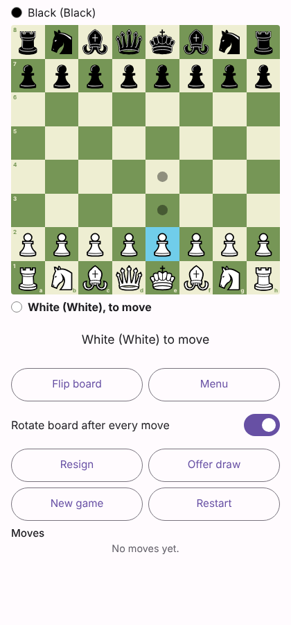
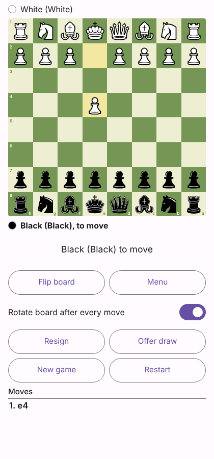
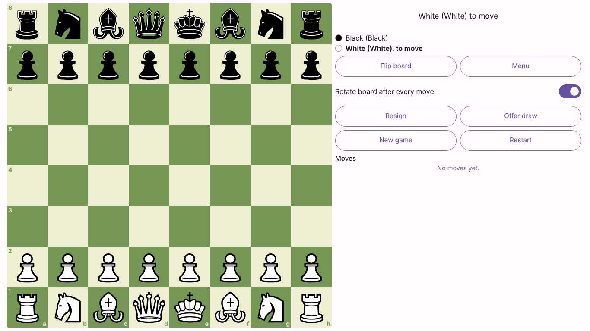
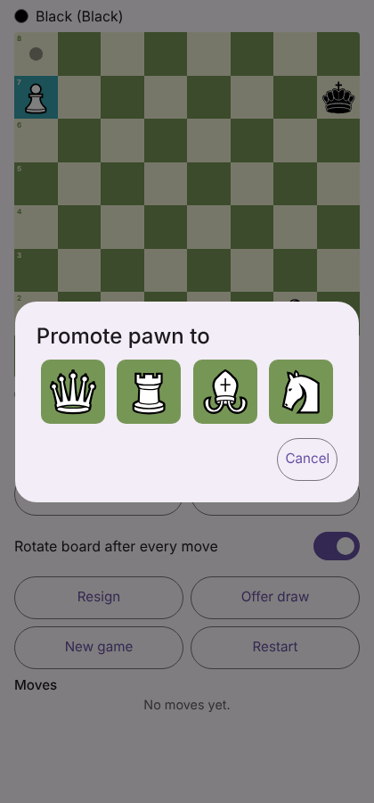

# Casual Chess (Web)

The browser version of the Casual Chess Android app (`../ChessApp`, left untouched): two players on one device, full
legal-move validation, legal-move highlights, automatic board rotation, promotion chooser, move history, and local
save/resume. It is a static site (Vite + TypeScript, no server, no accounts, no network calls).

| | |
|---|---|
| Chess rules | **[chess.js](https://github.com/jhlywa/chess.js) 1.4.0**, BSD-2-Clause (latest release June 2025) |
| Pieces | "Chessnut" by Alexis Luengas, Apache-2.0 (same set as the Android app) |
| Hosting | any static host; configured for Vercel (`vercel.json`) |
| Hosted test copy | https://claude.ai/artifact/4nMLTxgwpTxratPfqGxK3z (private claude.ai page, single file; not Vercel) |

## Run it

```bash
npm ci
npm run dev          # http://localhost:5173
npm test             # 106 unit tests (about 80 s: the cross-engine test replays 12,853 positions)
npm run test:e2e     # builds, then 20 end-to-end tests in a real browser (Playwright)
npm run build        # production build -> dist/
```
End-to-end tests need a Chromium: `npx playwright install chromium`, or set `CHROMIUM_PATH` to an existing Chrome/Chromium.
`E2E_BASE_URL=https://your-deployment npm run test:e2e` runs the same browser tests against any served copy
(including a Vercel preview).

## Deploy to Vercel

`vercel.json` in this folder configures a Vite static build (`npm ci`, `npm run build`, output `dist`). Your existing Vercel
project for `Graty/` is unaffected: this is a separate project. Two ways (from the Vercel CLI and general Vercel knowledge;
Vercel's docs and API were not reachable where this was written, so **no deployment was performed or verified**):

**A. Vercel CLI from your own machine (does not depend on Git branches)**
```bash
cd ChessWeb
npm ci
npx vercel login
npx vercel            # preview deployment -> prints a preview URL. Answer: set up and deploy? Yes; link to existing project? No;
                      # directory ./ ; the Vite settings are detected automatically
npx vercel --prod     # optional: production deployment
```
**B. Git integration (dashboard)**: Vercel -> Add New -> Project -> import this GitHub repository -> set **Root Directory** to
`ChessWeb` -> Deploy. Pushes to a non-production branch (such as `claude/wizardly-heisenberg-2eyysf`) get preview URLs.
Note the production branch (`main`) does not contain this folder until the work is merged, so the first production build of
`main` would fail with a missing root directory; deploy a branch preview first, or merge first.

Then run `E2E_BASE_URL=<your preview url> npm run test:e2e` to check the live deployment.

## What matches the Android app

Same screens (Home, Setup, Game, Settings), wording, 4 board themes, Chessnut pieces, legal-move dots/rings, last-move and
check highlights, 0.9 s "see the move, then rotate 180 degrees" flip (a click during the pause rotates immediately; pieces
stay upright), manual flip and auto-rotate switch, promotion chooser (Q/R/B/N), move history, claimable-vs-automatic draw
rules, resign (either player) and agreed draw, restart / new-game protection, autosave and resume.
The game logic is a TypeScript port of the Android app's `SessionState`/`ChessGame`/`GameCodec`, and the same rule tests were
ported.

## What differs (and known gaps)

* **Rules engine:** chess.js here; the Android app has its own Kotlin engine. They were cross-checked (below).
* **Draw rules are layered on top of chess.js.** chess.js treats threefold repetition and the 50-move rule as automatic game
  end and has no fivefold / 75-move rule. This app does not use `isDraw()`/`isGameOver()`: threefold and 50-move are
  *claimable*, fivefold and 75-move are *automatic* (a mating 75th move is still a win), as in the Android app.
* **Dead positions:** chess.js `isInsufficientMaterial()` (bare kings, K+B or K+N vs K, same-coloured bishops only). Locked
  pawn fortresses are not detected, as on Android. A brute-force test proves K+N v K and K+B v K contain no checkmate.
* **Threefold claim** is offered once the current position has occurred three times; claiming by announcing an intended
  move is not offered (same as Android).
* **Saves are per browser and per web address** (localStorage): the Vercel URL, `localhost` and the claude.ai copy each keep
  their own game. Private windows or blocked storage can disable saving; the game still plays.
* **Sounds** are synthesised with the Web Audio API (the Android app ships three generated WAV files); browsers play audio only
  after a click or tap.
* **No offline mode:** all code runs in the browser and nothing is sent anywhere, but there is no service worker, so the page
  needs a connection to load.
* Browser Back/Forward move between screens (the Android app has no equivalent).
* **Test hook:** opening `/?fen=<FEN>#/setup` makes "Start game" begin from that position (validated; invalid or "side not to
  move is in check" positions are rejected). It exists for the end-to-end tests (promotion, 50-move claim).
* No computer opponent, hints, undo or clocks (the "Play the computer" entry is disabled), as in Android milestone 1.
* **Accessibility:** squares are real buttons with spoken descriptions, the status line is a live region, all controls are
  48 px; **not tested with a screen reader**. Board squares are about 36 px on a 320 px phone.
* Different fonts and form controls than Android (system fonts, native `<dialog>`).
* Browsers tested: headless Chromium only. Safari, Firefox and real phones were **not** tested.

## How it was tested

| Check | Result |
|---|---|
| `tsc --noEmit` (strict) | clean |
| Perft through chess.js (start position to depth 4, Kiwipete, positions 3-6, up to depth 5) vs published counts | all match |
| 52 rule and draw-rule tests (pins, castling through/out of/into check, rights loss, en passant incl. exposed king, underpromotion, mate, stalemate, SAN, claimable vs automatic draws, 75th-move mate, repetition with castling rights / legal-only en passant, dead positions, resign/agree) | pass |
| **Cross-engine test**: the Android app's Kotlin engine played 150 random games (12,853 positions, from 10 start positions); chess.js + this game layer must give identical legal-move sets, SAN, check flags and results at every ply | **identical on all 12,853** |
| 10 save/resume tests (rights, en passant, repetition counts, 50-move counter, manual results, corrupt/forged saves rejected) | pass |
| Touch/click mapping after rotation: 7 geometry + 22 session tests, plus real pointer clicks in a browser | pass |
| 20 end-to-end browser tests: moves and highlights, rotation timing, early tap, promotion + cancel, mate, 50-move claim, resign/draw, reload + resume, restart/new-game protection, themes persisted, keyboard, Back, invalid FEN, About, 320x568 / 800x360 / 1366x768 layouts | 20/20 on the production build; 19/20 on the single-file copy inside an emulated host page (the one failure was a 404 for `/favicon.ico` from my local test server) |

Mutation check of the underlying rules was done on the Android engine (see `../ChessApp/README.md`); it was not repeated for chess.js.

## Layout

```
src/logic/   game.ts (chess.js wrapper + FIDE draw rules) session.ts (UI state machine) geometry.ts codec.ts describe.ts settings.ts
src/ui/      app.ts (screens, dialogs, flip timer, autosave) board.ts dom.ts sound.ts styles.css
tests/       *.test.ts (vitest), differential.test.ts + fixtures/kotlin-corpus.json, e2e/run.mjs (Playwright)
tools/       gen-pieces.mjs, make-artifact.mjs, CorpusExport.kt (how the cross-engine corpus was produced)
```

Licences: see `LICENSES.md`.

   

_Screenshots from the end-to-end run in headless Chromium._
